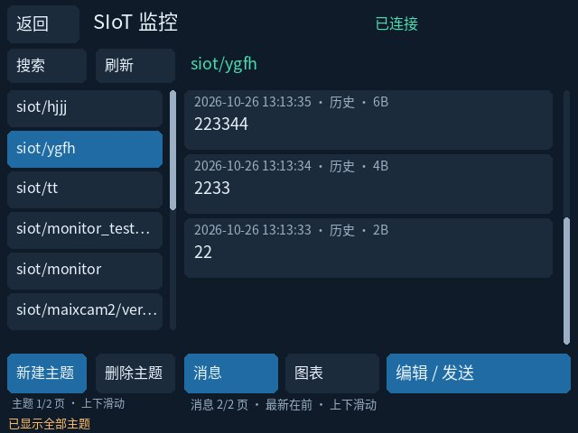
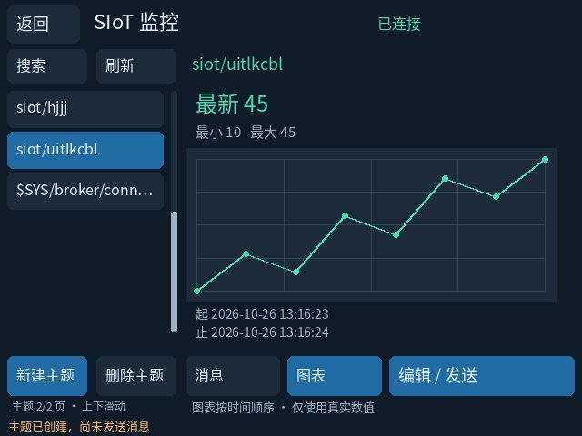
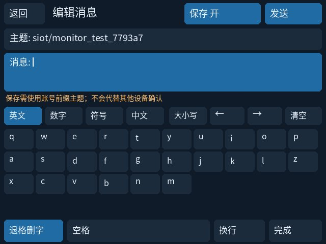
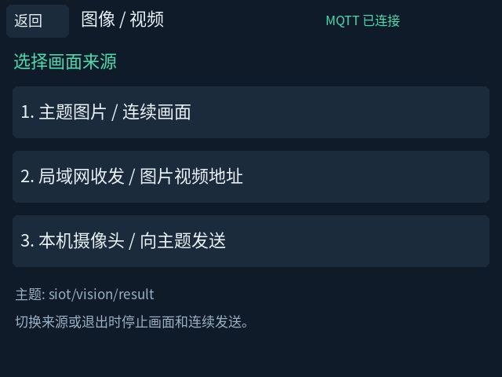
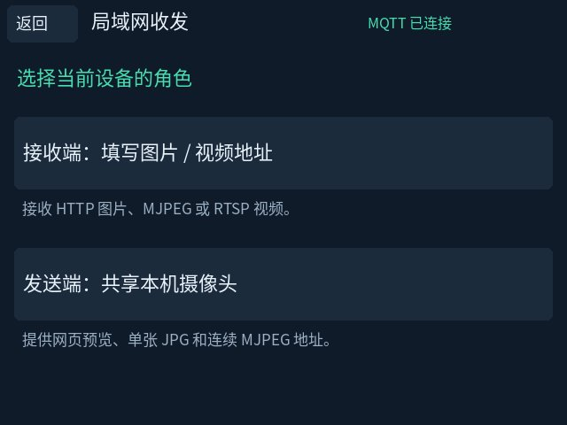
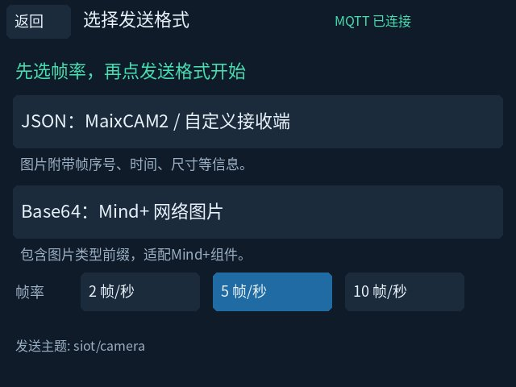

# 小智AI on MaixCAM2

把 Sipeed MaixCAM2 变成一台真正可用的小智（XiaoZhi）语音助手：**语音唤醒 → 对话 → 连续多轮 → 屏幕弹窗**。
协议实现对齐 [py-xiaozhi](https://github.com/huangjunsen0406/py-xiaozhi) v2.1.2。

本地开发版现有 **29 个 MCP 工具**，包含摄像头视觉问答、补光灯、板载外设、IMU实时显示与陀螺仪校准、受控外部I/O。详见 [MCP 功能清单](docs/MCP_CAPABILITIES.md) 和 [2026-10-25 开发汇总](docs/DEVELOPMENT_SUMMARY_2026-10-25.md)。外接I/O实物通信仍待验证。

当前交互：语音唤醒，或在左上角圆标持续按住2秒；X结束当前对话。普通触屏不再唤醒。扬声器音量/静音仅缩放播放PCM，不修改麦克风增益。

**SIoT 已可直接部署在 MaixCAM2 上作为局域网服务器，无需 PC 常驻。** 配套触屏监控支持主题管理、消息编辑、数字图表、图片和连续画面，以及小智拍照原图与云识别结果转发。详见 [SIoT 部署](docs/SIOT_DEPLOYMENT.md)、[图像传输与协议](docs/SIOT_MEDIA.md) 和 [监控 App](apps/siot_monitor/README.md)。

离线双模型、可视测试 App 和单线程唤醒优化仍属于实验；**离线模型/App MCP、通用 SIoT 发布订阅 MCP、运动识别与检测结果分发尚未实现**。已实现的拍照转发不等同于这些功能。源码见 [可视测试 App](examples/vision_model_test/) 与 [性能探针](tools/benchmarks/)，后续事项见 [NEXT_STEPS](docs/NEXT_STEPS.md)。

### 当前开发进度（2026-10-27）

| 模块 | 当前状态 |
|---|---|
| 小智语音与触屏交互 | 真实语音对话、X 退出后再次唤醒、圆标长按 2 秒唤醒已现场确认 |
| 29 个硬件 MCP | 摄像头、补光灯、IMU 实时显示/校准等已接入；外部 I/O 模块实物通信延期验证 |
| SIoT 服务 | ARM64 服务部署、MQTT/网页访问、历史回读与服务重启持久化已验证；可离线局域网使用 |
| 触屏监控 | 主题新建/二次确认删除、上下滑动、完整日期时间、退格输入、数字图表；清空数据保留主题，API 已验证，完整触屏流程待补验 |
| 图像/视频 | 主题收图、本机摄像头、局域网 HTTP/MJPEG 共享与 HTTP/RTSP 接收；当前 Mind+ Data URL 连续显示已确认，用户反馈媒体部分基本可用 |
| 拍照识别转发 | 原图与云识别结果通过相同 capture_id 关联，原 JPEG 字节不变；已验证真实拍照→云识别→MQTT 链路 |

连续画面提供 JSON / Base64 两种格式及 2 / 5 / 10 fps 目标速率，默认 5 fps。Mind+“网络图片”请选择 Base64（完整 `data:image/jpeg;base64,...`）。实时画面为 **320×240、JPEG quality 75**；小智拍照为 **640×480**。连续图片不保存历史，SIoT 管理网页的历史列表为空不能据此判断没有发送。

10 fps 档的一次订阅测量为 8 秒收到 71 帧（约 8.89 fps）；用户秒表照片显示过约 210 ms 的单次画面差。这些均不是稳定帧率或最大延迟保证，尚未达到或证明端到端 ≤100 ms。第二台 MaixCAM2/ESP32 接收显示、最新流媒体与真人语音共存、断电启动和长时间资源释放仍待验证。最新主机回归结果见下方“验证”。

拍照后屏幕会显示该照片 3 秒，再自动恢复聊天；调用 MCP 工具时，底部显示完整工具名称，结束后保留 3 秒。

设备：MaixCAM2（`maixcam2-test-device`，Ubuntu 22.04 / MaixPy 4.12.5 / Python 3.13 / 640×480 屏）

```
root@maixcam2-test-device:~# journalctl -u xiaozhi | tail -4
语音唤醒: 你好小智
→ listen start (第 1 轮)
← stt '你好，小智，今天天气怎么样？请用一句话告诉我。'
← tts sentence_start '江门今天阴天，31度，南风4级，湿度76%。'
```

---

## SIoT 实机界面

以下为开发验证时从设备捕获的 640×480 界面，内容为测试主题和消息。消息列表、图表截图来自较早阶段，尚未显示后来新增的“图像/视频”和“清空数据”入口；完整功能以当前源码及说明为准。

| 主题与消息（上下滑动） | 数字消息图表 |
|---|---|
|  |  |
| 消息编辑与退格键 | 图片与视频来源 |
|  |  |
| 局域网发送端/接收端 | JSON / Base64 与发送帧率 |
|  |  |

## 一、系统组成

| 部分 | 位置 | 职责 |
|---|---|---|
| **设置 App** | `/maixapp/apps/xiaozhi/` | 桌面图标「小智AI」。只做显示状态 + 改配置，写 `config.json` |
| **后台服务** | `/root/xiaozhi/`（systemd 开机自启） | 唤醒词常驻监听、连服务器、本地 VAD 断句、TTS 播放、状态栏/弹窗渲染 |
| **SIoT 服务（可选）** | `/opt/siot`、`/var/lib/siot` | 局域网 MQTT broker、网页管理与消息历史 |
| **SIoT 监控 App（可选）** | `/maixapp/apps/siot_monitor/` | 触屏主题/消息管理、图表、图片与摄像头收发 |

小智设置 App 与后台通过 `/root/xiaozhi/config.json` 和 `state.json` 交换数据，服务每 0.25s 轮询配置，改动即时生效。SIoT 连接配置单独保存在 `/etc/siot/monitor.json`。监控 App 使用界面所有权协调弹窗，本机摄像头预览与小智拍照通过协作锁互斥；第三方相机 App 不参与该锁。

弹窗靠 `LD_PRELOAD` 注入 launcher，在 `VO::push` 里把 RGBA 图层 alpha 混合进 640×480 帧；
弹窗可见时用 `EVIOCGRAB` 独占触摸设备，桌面不会被误触或滑动。

---

## 二、目录

```
xiaozhi/                交付物（部署到设备的就是这个目录）
├── service/
│   ├── xiaozhi_service.py   后台服务主程序（协议 / VAD / MCP / 音频 / 主循环）
│   ├── ui_render.py         状态栏 + 聊天气泡渲染 → popup.rgba / status.rgba
│   ├── hardware_tools.py    按需拍照、视觉分析上传、补光灯控制与停止清理
│   ├── ui_feedback.py       照片预览与 MCP 工具名称的临时显示生命周期
│   └── xiaozhi.service      systemd unit
├── app/                     设置 App（main.py / app.yaml / icon）
├── uishim/                  libmaixcam2_overlay.so 的源码（VO::push 注入 + 触摸接管）
├── deploy.sh                设备端一键部署
└── README.md                详细设计、排障、协议说明  ← 先看这个

diag/                   排查与标定脚本（在设备上跑）
├── proto_test.py / proto_test2.py   WS 协议端到端对照试验
├── xz_bisect.py                     定位「有 stt 无 tts」的变量对照
├── mic_cal.py                       麦克风增益标定
└── dl_probe.py                      最小下行客户端（关键排障工具，见下）

apps/siot_monitor/      SIoT 触屏监控、摄像头采集、MQTT/HTTP 媒体收发
tools/siot/             SIoT 服务与监控 App 初装、验证工具
tests/                  主机回归测试与平台相关检查
docs/SIOT_*.md          SIoT 部署、协议、实测与验证边界

ref/                    参考图与透视校正结果
shots/                  实机截图 / 帧抓取结果
device_snapshot/        改动前的原始程序（仅源码，模型与 .so 已排除）
```

---

## 三、部署

```sh
scp -r xiaozhi/ root@<设备IP>:/root/xiaozhi_src/
ssh root@<设备IP> 'cd /root/xiaozhi_src && sh deploy.sh'
```

`deploy.sh` 要求先回到设备桌面；停止小智后更新代码，编译新注入库，停止 launcher 并原子替换动态库，再按 launcher → 小智顺序启动。修订后的完整部署流程仍待下一次真机执行验证。
旧版本请先自行备份（本项目在设备上保留了 `*_legacy_<日期>` 快照）。

> **动手前务必读**：[设备部署说明](xiaozhi/README.md#六重新部署)。服务必须排在 launcher **之后**启动，
> 否则会开机黑屏（详见下）。

SIoT 是独立的可选安装步骤，请按 [SIoT 部署说明](docs/SIOT_DEPLOYMENT.md) 准备经过校验的 ARM64 分发包。仓库不附带供应包、数据库或凭据；初装器拒绝覆盖已有安装，不能把初装命令直接用作升级。SIoT 局域网功能不需要互联网，小智云端对话和云识别仍需要联网。

### 验证

在已具备项目测试依赖的 Python 环境中运行：

```sh
python -m unittest discover -s tests
git diff --check
```

2026-10-27 主机回归运行 391 项，389 项通过、2 项平台相关跳过。主机测试覆盖协议、队列、消息合并、媒体解析、资源所有权与交互逻辑；不能代替设备驱动、真实触屏、语音或端到端性能验收。设备实测与未验证项见 [SIoT 媒体说明](docs/SIOT_MEDIA.md#当前实测与仍待验证)。

---

## 四、踩过的坑（已修复问题与验证边界）

更新于 2026-10-26。下面保留上游排障经验，并补入 2026-10-25 新完成的修复；每项验证只覆盖对应场景，不代表所有性能和外设能力都已验收。

| 症状 | 根因或已确认的问题路径 | 修复与验证 |
|---|---|---|
| 唤醒后一直「聆听中」，服务器从不回话 | 旧版 `listen start mode="auto"` 持续上行，没有客户端断句；当时实测的服务端链路未自行结束该轮输入 | 改 `mode="manual"` 加本地能量 VAD，说话结束发送 `listen stop`。这是当时的协议排障结果，不代表所有服务端版本相同 |
| **开机黑屏**，launcher 杀不掉 | 音频先初始化 Maix 多媒体栈，桌面首帧 DRM commit 阻塞在 `drm_atomic_helper_wait_for_vblanks`，进入不可中断 D 状态 | unit 排在 launcher 之后，并等待桌面打开 `/dev/dri/card0` 再初始化音频 |
| **TTS 播放一顿一顿** | 阻塞式 `Recorder.record()` 的 pybind 调用持 GIL 约20ms，事件循环收包成簇 | 使用 `block=False`、100ms成块播放和自适应缓冲。该路径已修复，模型共存下的剩余延迟尖峰仍单独验收 |
| 弹窗盖住桌面却还能滑动 | overlay 只拦截自己 `open()` 的 fd，launcher 自己开的 fd 号不同 | 按 `fstat` 设备号识别，并加 `EVIOCGRAB` |
| TTS 无声 | 服务器固定 24k 输出，codec 只支持 16k/48k | 按 **Opus TOC 字节**解析帧长，再重采样到 48k |
| **点右上角X像是马上重启** | 服务其实未重启；原始触摸为480×640竖屏坐标，按钮按640×480横屏判断，X被误判为唤醒点击；顶边热区也有遗漏 | 转换坐标，分离关闭/喇叭热区；X取消当前会话，并丢弃关闭前排队的旧点击。现场确认可退出并重新唤醒，见[触摸修复](docs/TOUCH_CLOSE_FIX_2026-10-25.md) |
| 退出后，碰屏幕任意位置又唤醒 | 旧逻辑只屏蔽关闭后的短时间触摸，之后仍允许全屏触摸唤醒 | 改为**左上圆标区域持续按住2秒**；普通触屏不唤醒，移出/松手重计时，一次按压只触发一次 |
| 左上角长按2秒仍不生效 | 有效坐标位于MT槽位，普通 `EVIOCGABS` 当前坐标却为0；圆标处实际触点还落到左上边缘 | 读取 `EVIOCGMTSLOTS` 和 `BTN_TOUCH`，只接受一个有效触点；根据真实记录限定左上52×48像素热区。实际长按已记录到 `touch_hold` |
| 弹窗接管触摸后，松手状态可能丢失 | 独占抓取期间，另一读取者可能收不到release，SDK缓存的pressed不能代表当前手指状态 | 用只读内核按压/槽位快照确认松手，不消费或抢占桌面事件；异常和多指输入取消计时 |
| X退出后，再次语音唤醒有时无反应 | 积压解码可能漏掉中间命中；原清理流程先等网络关闭，再重置KWS。这是确认过的代码风险，不是每次失败的唯一归因 | 每次decode后检查结果，命中立即reset；本地KWS和状态恢复先于网络close。固定音频回归及用户真实重唤醒均通过 |
| **说了指令却一直聆听，20秒后退出** | 喇叭静音逻辑把影响采集的RX增益一起归零；麦克风帧数仍增长，RMS却接近0 | 音量和静音仅缩放播放PCM，恢复输入增益。静音前后输入增益不变，用户确认真实讲话有文字与声音，见[音频修复](docs/AUDIO_MUTE_CAPTURE_FIX_2026-10-25.md) |
| 拍照明显偏色、发白或明暗异常 | 相机刚打开就取图，自动曝光和白平衡尚未稳定 | 开启AE/AWB，至少读取30帧且等待2秒；用户确认颜色恢复正常，见[成像记录](docs/CAMERA_COLOR_FIX.md) |
| 预览文件已更新，屏幕仍显示旧内容 | 叠加层仅按秒级mtime判断缓存，同一秒替换文件可能不被发现 | 加入纳秒mtime与inode检查；同一张真实照片预览3秒后收起，见[显示反馈](docs/PHOTO_PREVIEW_MCP_FEEDBACK.md) |
| 按Func后后台音频停止、服务被重启 | Maix默认按键监听可能设置进程退出标志，不能直接解释为整机休眠 | 在后台主线程完成SDK初始化后移除该进程默认监听，保留只读按键事件；按键、麦克风计数与PID回读通过 |
| 输入拦截可能连功能键一起吞掉 | 仅靠输入设备号无法区分触摸屏和键盘/功能键 | 检查 `EV_ABS` 与完整坐标轴能力，只拦截触摸设备；原生回归验证按键字节透传 |
| IMU静止仍有角速度零偏 | 原始陀螺仪存在静态偏移，尚未做应用层校准 | 增加约3秒静止校准、查询、清除与保存；只扣一次零偏，运动/保存失败保留旧值。静止效果与重新加载已真机验证 |
| IMU温度0容易误解为真实温度 | 当前驱动提供的是不可用占位值 | 返回 `temperature_c=null`，屏幕显示“温度未提供” |
| 并行调用IMU时可能启动重复刷新循环 | 两个请求同时通过停止检查，各自启动轮询，后一个覆盖前一个任务引用 | 串行化完整IMU操作，随会话/界面清理轮询；大面板3秒后转实时底栏，见[IMU验收](docs/IMU_LIVE_CALIBRATION.md) |
| 测完App只显示菜单，没有小智聊天 | 为避免遮挡测试App，临时关闭了聊天弹窗；未恢复前看起来像显示故障 | 恢复原弹窗设置，并回读图层和服务状态；临时实验必须记录恢复结果 |
| 部署时小智反复启动超时 | 前台相机App正在运行，启动检查等不到launcher桌面 | 退出前台App、确认桌面DRM就绪后再启动服务；不绕过显示先于音频的约束 |

以下事项仍需继续验证，不能写成“全部解决”：

| 事项 | 当前进度 |
|---|---|
| 更新注入库及完整部署顺序 | 已改为临时文件编译、停止后原子替换、桌面先于音频；语法通过，完整脚本尚待再次真机执行 |
| 小智与双模型整机实时性 | 临时KWS单线程的5分钟软件候选基准通过；正式配置、真实语音、光学端到端与长期稳定性仍需完整验收 |
| 可视测试页刷新率 | 首版实显约13FPS，已定位绘字开销；缓存/内置字体优化源码已保存，优化后实显尚待复测 |
| 旧App引用的自定义模型 | 仍有输出节点/张量索引兼容问题，不能用另一套能运行的模型代替验收 |
| 外接GPIO/I²C/SPI/UART模块 | 保护逻辑及部分控制器检查通过，真实外接模块通信按约定延期 |

完整进度见[开发汇总](docs/DEVELOPMENT_SUMMARY_2026-10-25.md)与[后续任务](docs/NEXT_STEPS.md)。

### 一条排障教训

播放卡顿排查时，我在服务进程内测得「服务端下发只有 0.61× 实时」，差点得出"服务端不行"的结论。
后来写了个**最小客户端**（不跑麦克风/唤醒/界面渲染，只连 WS 收音频）复测：

```
帧间隔: 平均19.9ms 中位20.0ms p95=23.3ms 最大49.0ms | >60ms 停顿 0 次 | 0.97× 实时
```

这次对照说明：0.61× 的测量受本机 GIL 阻塞影响，不能据此归咎服务端；这不是对所有网络环境和后续服务端版本的保证。

> **怀疑链路问题时，先用最小复现端对照，别在复杂进程里量。**

`diag/dl_probe.py` 就是那个最小客户端，留在仓库里备用。

---

## 五、协议要点（对齐 py-xiaozhi v2.1.2）

* **OTA** `POST {ota_url}`，头 `Device-Id / Client-Id / Activation-Version: 2`；
  激活 `POST {ota_url}/activate`，`hmac-sha256(key=hmac_key, msg=challenge)`，200 成功 / 202 等用户输码。
* **WS** `Authorization: Bearer <token>` / `Protocol-Version: 1`；
  `ping_interval=20 ping_timeout=20 max_size=10MB compression=None`。
* **上行** Opus 16k 单声道 20ms（320 样点），`APPLICATION_VOIP`。
* **下行** Opus 24k 单声道，帧长由每包 TOC 字节解析。
* **MCP** JSON-RPC 2.0：`initialize` / `tools/list`（按 name 游标分页，8000B 预算）/ `tools/call`。

---

## 六、仓库里有什么 / 没有什么

**包含**（约 58MB）：

- 全部自写代码与排障脚本
- 唤醒模型 `models/zh/`（sherpa-onnx KWS zipformer-wenetspeech-3.3M，12MB）
- 预编译运行库 `sherpa_rt/lib/`（libsherpa-onnx + libonnxruntime，38MB）

**不包含**：

- `config.json` / `state.json` —— 含设备凭据（`hmac_key` / `client_id` / `serial_number`）。
  首次启动会自动生成，模板见 `device_snapshot/root_xiaozhi/config.example.json`
- `*.raw` / `*.rgba` 原始帧转储、`__pycache__`
- SIoT 用户供应包、数据库、连接凭据、证书私钥和 `.runtime/` 内的测试记录、相机画面

第三方组件的来源与许可见 [THIRD_PARTY.md](THIRD_PARTY.md)。


板载用户LED、Func状态/事件、六轴IMU、RTC和ADC原始读取已接入；GPIO/I²C/SPI/UART使用本地白名单，默认不开放目标。详见 [外设验收](docs/PERIPHERAL_MCP_VALIDATION.md) 与 [访问配置](docs/IO_ACCESS.md)。
