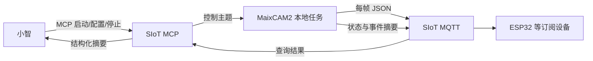

# 视觉识别结果与 SIoT 发布设计

状态：设计阶段，尚未实现或连接实际 SIoT 服务。下面的工具名、主题和数据结构均为拟议契约，不代表当前已安装同名 MCP 工具。

## 目标与职责

小智负责接受语音意图、启动/配置/停止任务和解释摘要。MaixCAM2 负责离线推理、连续帧判断和高频数据发布。SIoT 作为 MQTT 分发服务，接收设备订阅所需数据。



不让每帧都等待一次大模型工具调用。若现有 SIoT MCP 只支持单条发布，就由它发布启动命令，本地任务持续推流；必须先核对其实际接口，而非假设它具备流式任务能力。

## 主题契约

| 主题示例 | 内容 | 候选传输策略 |
|---|---|---|
| `vision/control` | 任务启动、停止、模型组合、频率 | 带请求 ID，设备回复实际接受/就绪状态 |
| `vision/frames` | 每帧类别、分数、框、可选关键点 | 优先低延迟，不保留旧帧，不默认历史入库 |
| `vision/events` | 连续帧形成的动作事件 | 带事件 ID，接收端去重，可独立保存 |
| `vision/status` | 就绪、运行、错误、实际频率、丢帧、最近处理序号 | 保留明确的在线状态和更新时间 |

QoS、保留消息、历史存储及会话机制要按 SIoT 版本和客户端能力实测。可考虑帧流 QoS 0、事件 QoS 1，但发布成功不等于接收设备已处理成功；接收端应回报最近接收/处理序号及计数。

## 每帧数据结构

以下仅为结构示例，不是实际识别结果：

```json
{
  "v": 1,
  "stream_id": "example_run_001",
  "seq": 128,
  "capture_ts_ms": 1792926000000,
  "ttl_ms": 200,
  "image_size": [320, 320],
  "bbox_format": "camera_normalized_xywh",
  "results": [
    {
      "model_id": "pose",
      "label": "standing",
      "score": 0.91,
      "bbox": [0.20, 0.10, 0.35, 0.80]
    },
    {
      "model_id": "objects",
      "label": "person",
      "score": 0.94,
      "bbox": [0.19, 0.09, 0.37, 0.82]
    }
  ],
  "valid": true,
  "truncated": false
}
```

- 所有框先映射回同一原始摄像头坐标，再归一化到 0～1，原点为左上角；明确旋转、裁剪及填边关系。
- `stream_id` 区分任务，`seq` 区分帧并支持去重；重新开始任务不能无标识地重置序号。
- 正式目录还应记录模型及完整依赖版本。分数保留模型原始含义，不直接当作业务事件的已校准概率。
- 无目标时发送有效空结果 `results: []`，接收端据此清除旧框。采集/推理失败与无目标分开表达。
- 框数量、关键点数量和消息字节数有上限；截断时显式标记，接收缓冲必须覆盖约定的最大消息。
- 时间戳跨设备计算需同步时钟；未同步时不能把两个设备时钟相减宣称单向延迟。

## 实时性与丢帧策略

正常链路按每个处理帧发布。推理与网络发布使用独立的有界队列；实时模式拥塞时丢旧保新并统计丢帧，不能无限排队让旧画面延迟到达。

如果需求是一帧不丢，应另建可靠记录/回放通道，并明确它不具备与实时通道相同的延迟承诺。不要把重传或积压后补发算作实时更新。

接收端应拒绝过期、乱序和重复数据；断流后清除或标记旧状态。原有“每模型至少 20 次/秒、最大延迟不超过 100 ms”验收需要扩展到采集、推理、序列化、发送排队、MQTT 分发及接收处理全链路，而非仅看 NPU 推理耗时。

## 运动观察结果

每帧框与“是否有人做运动”不是同一层数据。现有姿态分类输出只能表明某一帧的姿态；判断动作还需要：

1. 可靠的人体/关键点输入与稳定目标关联。
2. 连续时间窗口内的关键点可见率、位移、关节变化和动作周期。
3. 限定的首批动作及清晰的未知、遮挡、人数变化、数据不足条件。
4. 结果归纳为动作模式与计数，避免把一次坐下或躺下直接解释为锻炼或摔倒。

设备已有的人体姿态分类 App 可提供静态姿势规则参考，但它不是现成的运动事件识别服务。人体检测与关键点模型也可能重复完成一部分检测，需按性能和准确率决定采用双模型，还是先用姿态模型加时序规则。

最终事件应含任务 ID、目标 ID、观察窗口、动作类型、完成周期数和质量信息。小智读取事件摘要再解释；接收设备可独立订阅逐帧数据或事件，不必等待语音回复。

## MCP 与任务生命周期

拟议接口可按实际 SIoT MCP 能力调整：

- 启动：指定已登记的模型/流水线 ID、发布配置和观察时长，返回任务 ID。
- 查询：返回加载、预热、观察、完成、失败或取消状态，以及结果与实际发送统计。
- 停止：停止本任务并确认相机、模型和发布资源释放。

启动命令已发布、设备已接受、模型已就绪、接收端已收到数据应分别确认。长任务需要实际验证小智是否会继续查询，不能假设设备可自行发起云端对话或云端一定会自动轮询。

连接凭据留在本地配置，MCP 参数使用已登记的连接配置 ID。模型与主题也通过登记项选择，不接受任意脚本、任意命令或未验证路径。

## 实施前置条件

- 完成可视化优化版与单线程 KWS 的真实语音共存验收。
- 确认实际 SIoT 版本、MCP 工具定义、主题约束、认证与接收设备。
- 定义每帧最大消息、实时/可靠策略及端到端计时方法。
- 用接收端回执完成发布、订阅、断连、重连、乱序、过期和去重测试。

SIoT 的 MQTT 发布/订阅能力参考其[官方使用说明](https://siot.readthedocs.io/zh-cn/latest/7.attach/siotlib.html)。本项目的接入和性能仍须独立验证。
